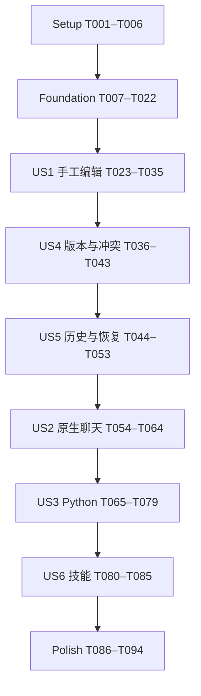

# Tasks: VS Code 原生聊天驱动的 Office 文档编辑

**Input**: `specs/001-vscode-office-editor/` 中的 [spec.md](spec.md)、[plan.md](plan.md)、[research.md](research.md)、[data-model.md](data-model.md)、[contracts/](contracts/) 和 [quickstart.md](quickstart.md)。

**Status**: 实施进行中，T001–T043已完成基础实现与本机验证，US5实施中；仅在对应实现与验证通过后勾选，未完成项不代表已实现或已测试。实际 Git 分支仍为 main，feature ID 为 001-vscode-office-editor。

**Tests**: 依据规格的 Independent Test、失败场景及量化成功标准，纳入保真、原子性、历史、版本、类型、集成和性能验证。测试任务先定义预期失败再实现对应能力；不额外要求低风险文案修改采用 TDD，不运行真实模型来替代确定性测试。真实聊天验收必须单独取得证据。

**Organization**: 每个用户故事独立成阶段。US1、US2、US3、US4、US5 均为 P1，同优先级内按安全依赖执行 US1 → US4 → US5 → US2 → US3；US6 为 P2。先提供可独立演示的手工编辑，再完成可交付的保存/历史/冲突闭环。

## Format: `[ID] [P?] [Story] Description`

- 每条任务使用 `- [ ] Tnnn [P?] [USn?]`，含仓库相对文件路径与完成条件。
- `[P]` 仅指在注明前置任务完成后、与同阶段独立文件任务可并行，不代表可跳过依赖，也不表示必须启用多代理。
- Setup、Foundational、Polish 不带故事标签；故事阶段必须带对应 US 标签。所有文件路径是拟新增或修改位置，不能因为文件不存在而省略实现。
- 宪章仍为未填写模板，本次不虚构治理约束；遵循现有 CLAUDE.md 主题/i18n和宿主构建规则。

## Path Conventions

- `apps/vscode-office/`：新 VS Code workspace extension、Webview入口、技能和验收脚本。
- `packages/workbook-session/`：无 Electron/vscode/React/Univer 导入的 Node 权威会话库。
- `packages/sheets-editor/`：无 Node/Electron 的浏览器表格组件与候选解释器。
- `packages/xlsx-gateway/`、`apps/sheets/`：复用及渐进抽取；旧导入保持兼容，不复制大型 App.tsx，不以空 DesktopApi 绕过缺失功能。
- 凡开发报告或性能数据均写 `apps/vscode-office/test-results/`，标明环境、版本和实际执行状态，不将未执行项标完成。

## Phase 1: Setup (Shared Infrastructure)

**Purpose**: 建立三个 workspace、运行环境边界和约定脚本，使后续任务可在统一构建中完成。

- [X] T001 在 `apps/vscode-office/package.json`、`packages/workbook-session/package.json`、`packages/sheets-editor/package.json` 建立扩展/Node库/浏览器库；固定扩展 `engines.vscode: ^1.109.5`、`extensionKind: ["workspace"]`，沿用 TypeScript5.9、React19、Univer0.25.1 和 Node22兼容目标，不添加独立聊天或Python运行时。
- [X] T002 在三个包的 `tsconfig.json`、`apps/vscode-office/esbuild.config.mjs`、`apps/vscode-office/vite.config.ts` 和 `packages/sheets-editor/vite.config.ts` 配置宿主/浏览器分离构建，externalize vscode，静态检查新Webview不引入Node/Electron/模型服务；提供plan及quickstart约定的build/typecheck脚本（依赖 T001）。
- [X] T003 [P] 在 `packages/workbook-session/vitest.config.ts` 和 `packages/workbook-session/tests/helpers.ts` 建立临时文件、冻结时钟、错误注入及会话测试基础；测试资源按用例清理（依赖 T002）。
- [X] T004 [P] 在 `packages/sheets-editor/vitest.config.ts`、`packages/sheets-editor/playwright.config.ts` 和 `packages/sheets-editor/tests/helpers.ts` 建立浏览器组件、候选runtime资源计数与命令拦截测试基础（依赖 T002）。
- [X] T005 [P] 在 `apps/vscode-office/.vscode-test.mjs`、`apps/vscode-office/playwright.config.ts` 和 `apps/vscode-office/tests/helpers.ts` 配置最低1.109.5与当前稳定版的Extension Host测试、独立profile和Webview端到端入口；补齐test/test:integration/test:e2e脚本（依赖 T002）。
- [X] T006 在 `package.json`、`package-lock.json`、`eslint.config.mjs` 和新包各自 `package.json` 接入构建/类型检查/测试发现及依赖锁定，保留现有workspace脚本行为；不升级无关依赖（依赖 T003、T004、T005）。

**Checkpoint**: 三包可构建，测试宿主可启动，环境边界检查可运行；尚不宣称文档可编辑。

## Phase 2: Foundational (Blocking Prerequisites)

**Purpose**: 先验证最危险的技术假设，完成所有故事共享的状态、候选事务、消息和保真基础。

- [X] T007 在 `packages/workbook-session/src/domain.ts` 和 `packages/workbook-session/src/schemas.ts` 定义WorkbookDocument/State/CellRecord/Receipt/HistoryEntry及稳定错误；落实“schemaVersion=1，未知版本拒绝”、“revision：会话内单调非负整数；内容 commit/undo/redo 每次 +1；save、选区变化、索引进度不改变内容 revision”和稳定logicalSheetId，typed空串不等于null（依赖 Phase 1）。
- [X] T008 在 `packages/workbook-session/src/ports.ts` 和 `packages/sheets-editor/src/ports.ts` 定义WorkbookSource、CandidateInterpreter、ResourceStore、PackageWriter、HostLifecycle及浏览器数据端口，输入固定stateId、取消信号，输出可序列化changeset；禁止公共端口泄露Electron/VSCode/React refs/Univer闭包（依赖 T007）。
- [X] T009 [P] 在 `packages/sheets-editor/tests/candidate-spike.spec.ts` 验证同版Univer隔离candidate、手工命令预拦截、结构/图表变化可序列化及失败丢弃；至少注入执行到第N项失败并证明主状态未改，释放后无残留runtime（依赖 T008）。
- [X] T010 [P] 在 `apps/vscode-office/tests/integration/stable-api-spike.test.ts` 验证1.109.5的CustomEditor、LM工具注册、准备描述与invoke边界、edit event及save/undo回调；禁止enabledApiProposals，不假设全局聊天发送事件（依赖 T008）。
- [X] T011 在 `apps/vscode-office/test-results/g0-design-proof.md` 记录T009/T010和最小“结构+图表—序列化保存—逆变更恢复”的实际证据、能力白名单及局限；有失败则修复该原型并复测，不能以非原子、丢历史或空实现通过G0（依赖 T009、T010）。
- [X] T012 [P] 将Node客户端抽到 `packages/workbook-session/src/sidecar/client.ts`，旧 `apps/sheets/src/main/xlsx-sidecar-client.ts` 保留兼容转导出；保留协议版本/请求ID/会话检查、30秒控制与180秒归档超时及崩溃清理，不使用Electron资源目录（依赖 T011）。
- [X] T013 [P] 在 `packages/xlsx-gateway/src/shared/workbook-protocol.ts` 抽取双方需要的纯schema，将 `apps/sheets/src/shared/desktop-api.ts` 改为兼容导入/转导出；保留原有ZIP/范围/500MiB条目限制，不迁入整个DesktopApi（依赖 T011）。
- [X] T014 在 `packages/workbook-session/src/resources.ts` 和 `packages/workbook-session/src/open.ts` 实现不可变原包快照、摘要、archive manifest与sidecar引用；区分完整URI、真实路径和同物理目标alias，确保读取基于复制后的同一份bytes（依赖 T012、T013）。
- [X] T015 在 `packages/workbook-session/src/state.ts`、`packages/workbook-session/src/sheet-map.ts` 实现base+typed overlay+ordered structural log，落实“overlayRoot：永远相对 originalBase”和保存不改变logicalSheetId；所有历史引用有效前不得回收base（依赖 T014）。
- [X] T016 在 `packages/workbook-session/src/read.ts` 和 `packages/workbook-session/tests/read-current.test.ts` 实现immutable read view合成当前值/公式/格式、结构后的坐标和分页；覆盖未保存修改、索引未完、隐藏视图与原始值/显示值区别，无法读取时明确失败（依赖 T015）。
- [X] T017 [P] 在 `packages/workbook-session/src/store.ts` 和 `packages/workbook-session/tests/store.test.ts` 实现私有chunks/原子manifest/引用清理，先写全部引用再发布根；覆盖写入中断，拒绝半manifest，记录真实序列化字节（依赖 T016）。
- [X] T018 [P] 在 `packages/sheets-editor/src/candidate.ts`、`packages/sheets-editor/src/changeset.ts` 抽取可生产使用的隔离执行器，复用现有DSL/保护/公式预算；收集值、样式、结构、图表、引用及计算结果的完整前后变化，现有partiallyApplied只污染可丢弃candidate，不能污染主状态（依赖 T016、T011）。
- [X] T019 在 `packages/workbook-session/src/history-records.ts` 和 `packages/workbook-session/tests/changeset-budget.test.ts` 实现可序列化双向changeset、state roots和实际字节预检；严格执行“每事务双向变化 <=64 MiB，保留 timeline <=256 MiB”，不接受闭包/内部unit IDs或提交后才降级不可撤销（依赖 T017、T018）。
- [X] T020 在 `packages/workbook-session/src/transactions.ts` 实现每文档串行队列、received/preparing/prepared/committed与rejected/cancelled、持久receipt及原子根切换；先幂等后revision检查、取消按commit point区分、提交后投影失败保留已提交事实（依赖 T019）。
- [X] T021 在 `packages/sheets-editor/src/bridge.ts`、`apps/vscode-office/src/extension/editor-bridge.ts` 定义/接入protocolVersion1消息；限制JSON消息1MiB、chunk256KiB，校验request/session/method及完整摘要，不能携带任意路径/代码执行，投影可从canonical重建（依赖 T020）。
- [X] T022 在 `packages/workbook-session/tests/transactions.test.ts`、`packages/sheets-editor/tests/projection.spec.ts` 和 `apps/vscode-office/test-results/foundation.md` 验证原子提交、取消前后、丢响应重试、投影失败重建及Electron兼容导入；G0/G1证据通过后才进入故事阶段（依赖 T021）。

**Checkpoint**: 一个文档只有一份权威状态；手工/AI/导入可共享相同事务接口；任意失败不能以伪成功通过。所有故事依赖本阶段。

## Phase 3: User Story 1 — 打开与手工编辑 (Priority: P1, MVP演示)

**Goal**: 不依赖聊天、模型或Python，在VS Code打开多表工作簿、编辑并保存原生格式。

**Independent Test**: quickstart V1基础部分；关闭AI，查看两表、改值/基础公式/常用格式、保存另存为后重开，未改内容保持。

### Tests for User Story 1

- [X] T023 [P] [US1] 在 `apps/vscode-office/tests/manual-workbook.test.ts` 同时在 `apps/vscode-office/tests/fixtures/manual-workbook.ts` 创建独立小型两表/类型/格式夹具（不依赖后续Python夹具任务），定义打开/编辑/dirty/保存/另存为/重开/无AI及损坏文件场景，固定源fixture摘要（依赖 Phase 2）。
- [X] T024 [P] [US1] 在 `packages/sheets-editor/tests/manual-intents.spec.ts` 定义输入法flush、值/公式/格式、sheet/结构/图表命令白名单及保护约束，验证未支持命令不绕过host（依赖 Phase 2）。

### Implementation for User Story 1

- [X] T025 [US1] 在 `apps/vscode-office/src/extension/workbook-document.ts` 实现每URI一个CustomDocument及session生命周期，维护stateId/savedStateId/dirty、只读能力和dispose；禁止basename作为身份（依赖 T023、T024）。
- [X] T026 [US1] 在 `apps/vscode-office/src/extension/provider.ts` 和 `apps/vscode-office/src/extension/activate.ts` 注册.xlsx自定义编辑器及open命令，单文档单视图、workspace信任及URI映射、nonce CSP/asWebviewUri/localResourceRoots，明确拒绝不支持平台/资源（依赖 T025）。
- [X] T027 [US1] 在 `packages/sheets-editor/src/WorkbookEditor.tsx`、`packages/sheets-editor/src/runtime.ts` 和 `apps/vscode-office/src/webview/main.tsx` 接入共享表格、工作表切换、区域加载及canonical投影；从既有模块抽取而非复制App或内置AI面板（依赖 T026）。
- [X] T028 [US1] 在 `packages/sheets-editor/src/manual-intents.ts` 接入值/基础公式、font/bold/italic/颜色/fill/number format/对齐/wrap/border、fill/copy的预执行intent与输入法flush，内部装载命令不产生用户历史，用户修改统一经过事务（依赖 T027）。
- [X] T029 [US1] 在 `packages/sheets-editor/src/WorkbookEditor.tsx`、`packages/xlsx-gateway/src/domain/session-candidate.ts` 和 `packages/workbook-session/src/candidate-material.ts` 实现sheet增删改名和受限行列插删，重用引用与保护校验；结构后的逻辑ID、坐标和全量changeset一致（依赖 T028）。
- [X] T030 [US1] 在 `packages/sheets-editor/src/WorkbookEditor.tsx`、`packages/sheets-editor/src/BasicChart.tsx`、`packages/xlsx-gateway/src/domain/session-chart-references.ts` 和共享候选解释器接入column/bar/line/pie基本图表的创建编辑、数据引用和可序列化逆状态，不持久化旧renderer闭包（依赖 T029）。
- [X] T031 [US1] 在 `packages/workbook-session/src/package-writer.ts` 和 `packages/xlsx-gateway/src/gateway/xlsx-package-io.ts` / `xlsx-gateway.ts` 实现从originalBase+完整overlay的staged序列化；结构与图表等所有子阶段在私有包完成后保真校验，不提前写用户原件（依赖 T030）。
- [X] T032 [US1] 在 `apps/vscode-office/src/extension/save.ts` 接入save/saveAs与取消/只读/磁盘满反馈，保存只更新saved marker/hash不换session，不擅自改CustomDocument.uri；新目标重开采用新session（依赖 T031）。
- [X] T033 [P] [US1] 在 `apps/vscode-office/src/webview/theme.css` 和 `packages/sheets-editor/src/i18n/` 接入VS Code语义UI主题和共享语言约束，所有新增语言键同步；文档填色/字体/导出内容不被主题重写（依赖 T027）。
- [X] T034 [US1] 在 `apps/sheets/src/renderer/create-univer.ts`、`apps/sheets/src/main/xlsx-sidecar-client.ts`、`apps/sheets/src/shared/desktop-api.ts`、`apps/sheets/src/shared/ipc-channels.ts`、`apps/sheets/electron.vite.config.ts` 和shell构建适配抽取后的共享模块，保留原Electron行为及真实main/preload构建路径，不迁入VSCode权限逻辑（依赖 T032、T033）。
- [X] T035 [US1] 执行T023/T024及quickstart V1基础/无AI验证，将实际结果写 `apps/vscode-office/test-results/us1-manual.md`；验证保存重开值/公式/格式和未触及OOXML内容，失败修复后再完成故事（依赖 T034）。

**实现位置说明**：US1结构/图表逻辑共用纯候选解释器，保存复用既有gateway序列化，Electron保持兼容转导出；上述路径按实际落地调整，需求与验收范围未缩减。证据及当前局限见 `apps/vscode-office/test-results/us1-manual.md`。

**Checkpoint**: 可独立演示手工编辑MVP；US4/US5未通过之前不声明已达到完整数据安全/历史交付标准。

## Phase 4: User Story 4 — 版本、冲突与失败隔离 (Priority: P1)

**Goal**: 明确目标/版本，过期结果、外部覆盖、关闭重开和失败批次不能覆盖新内容。

**Independent Test**: 不需要模型，通过会话/工具测试调用在读写间插入手工修改、结构变化、磁盘修改及close/reopen，完整执行quickstart V5对应场景。

### Tests for User Story 4

- [X] T036 [P] [US4] 在 `packages/workbook-session/tests/freshness.test.ts` 定义ABA、结构变更、同名URI、close/reopen、revert/recovery旧token及并行读写用例，断言零错误目标写入（依赖 US1）。
- [X] T037 [P] [US4] 在 `apps/vscode-office/tests/conflict-faults.test.ts` 定义外部改磁盘、提交前/后故障、重复transaction及投影丢响应集成场景，不能以通用跨进程CAS替代实际冲突测试（依赖 US1）。

### Implementation for User Story 4

- [X] T038 [US4] 在 `packages/workbook-session/src/bindings.ts` 实现TaskBinding，落实“status 为 active / stale / invalidated”、frozenRange可空、关闭/revert/recovery失效且不能跨窗口；结构变更产生selection_stale_structure并要求重新绑定原选区（依赖 T036、T037）。
- [X] T039 [US4] 在 `packages/workbook-session/src/freshness.ts` 接入所有读写/prepare/commit的session和expectedRevision检查，任意内容/undo/redo递增revision，候选完成仍复核，save/索引/选区不改变内容revision（依赖 T038）。
- [X] T040 [US4] 在 `apps/vscode-office/src/extension/file-conflicts.ts` 和 `packages/workbook-session/src/publish.ts` 接入watcher与baseline摘要、POSIX/Windows发布前后检查、保留old/staged副本及冲突另存为入口；不静默覆盖、合并或丢dirty（依赖 T039）。
- [X] T041 [US4] 在 `packages/workbook-session/src/registry.ts` 和 `apps/vscode-office/src/extension/provider.ts` 实现alias锁与每打开epoch、dispose失效和同路径新会话隔离；不能将旧绑定自动迁移到新CustomDocument（依赖 T040）。
- [X] T042 [US4] 在 `packages/workbook-session/src/receipts.ts` 实现会话级幂等记录与operationStatus所需查询：同transactionId+同payload返回原收据、异payload报idempotency_conflict，必须先查幂等再判断过期版本（依赖 T041）。
- [X] T043 [US4] 运行T036/T037及故障注入验证，将revision/来源/commit point/恢复证据写 `apps/vscode-office/test-results/us4-conflicts.md`；确保失败当前批无残留、提交后错误仍可查收据（依赖 T042）。

**Checkpoint**: US4能在无模型环境独立验收；后续聊天和Python不得另走绕过本层的写入路径。

## Phase 5: User Story 5 — 保存、撤销、重做与恢复 (Priority: P1)

**Goal**: 手工/AI批次共享历史，保存后结构与图表仍可撤销，关闭和异常恢复保留明确恢复点。

**Independent Test**: 按手工—受控事务批次—手工修改顺序，保存前后撤销/重做、重存重开，注入保存失败与异常退出，执行quickstart V1/V4/V5历史相关场景，无需模型。

### Tests for User Story 5

- [X] T044 [P] [US5] 在 `apps/vscode-office/tests/history-lifecycle.test.ts` 定义手工/事务混合、一批一个undo、结构/图表跨保存undo/redo、无双历史及dirty marker断言（依赖 US4）。
- [X] T045 [P] [US5] 在 `packages/workbook-session/tests/recovery.test.ts` 定义backup写中断、引用清理、backupId恢复、新session、只保证最后确认副本及不可撤销预算拒绝场景（依赖 US4）。

### Implementation for User Story 5

- [X] T046 [US5] 在 `packages/workbook-session/src/history.ts` 实现host timeline、HistoryEntry稳定前后state根、逆变化及redo分支；“新内容 commit 清空 redo 分支；save 不改变 timeline”，undo回旧stateId但revision继续增长（依赖 T044、T045）。
- [X] T047 [US5] 在 `apps/vscode-office/src/extension/document-history.ts` 和 `packages/sheets-editor/src/history-bridge.ts` 将每成功事务映射一次CustomDocumentEditEvent，undo/redo回调与Webview快捷键走同一host历史，历史移动不再发一条新edit event（依赖 T046）。
- [X] T048 [US5] 在 `packages/workbook-session/src/save-state.ts` 和 `apps/vscode-office/src/extension/save.ts` 完成保存后不清overlay/历史、不换sidecar、原base重放结构不重复、savedStateId与dirty正确；覆盖多阶段staged保存的图表/结构逆变化（依赖 T047）。
- [X] T049 [US5] 在 `packages/workbook-session/src/recovery.ts` 和 `apps/vscode-office/src/extension/backup.ts` 实现base/overlay/feature maps完整备份，“先写所有引用文件，再原子发布 manifest，最后确认 backupId”；恢复新session，备份引用存活前不清base（依赖 T048）。
- [X] T050 [US5] 在 `apps/vscode-office/src/extension/provider.ts` 接入revert/关闭保存放弃取消/backupId恢复/backup删除，遵循VSCode生命周期；不承诺首版跨进程恢复整条undo历史（依赖 T049）。
- [X] T051 [US5] 在 `packages/workbook-session/src/history-budget.ts` 将64MiB单事务/256MiB保留历史预检接到所有manual/agent/import/history入口；保存不剪裁，超限执行前明确拒绝并提示缩小批次（依赖 T050）。
- [X] T052 [US5] 在 `apps/vscode-office/tests/save-recovery-faults.test.ts` 补齐磁盘满、只读目标、另存为取消、异常结束及Webview隐藏/销毁集成测试，确保失败保留内容/历史且不报保存成功（依赖 T051）。
- [X] T053 [US5] 完成T044/T045/T052及V1/V5历史恢复验收，将实际结果与限制写 `apps/vscode-office/test-results/us5-history.md`，作为G2安全手工编辑交付门槛（依赖 T052）。

**Checkpoint**: US1+US4+US5构成可交付的手工编辑闭环；后续故事只复用已有会话、冲突及历史，不创建并行模型。

## Phase 6: User Story 2 — 原生聊天读写当前文档 (Priority: P1)

**Goal**: 原生Agent读到当前未保存内容，绑定明确目标并应用真实、可撤销修改；只问答不改文档。

**Independent Test**: 先确定性调用真实工具注册/会话，验证读取/修改/统计/焦点切换/审批；再从原生聊天完成区域问答和公式/格式修改，按quickstart V2记录证据。

### Tests for User Story 2

- [X] T054 [P] [US2] 在 `apps/vscode-office/tests/agent-tools.test.ts` 定义context/read/aggregate/apply/operationStatus五个基础工具输入输出，三个文件交换工具在US3完成前不注册、不提供空实现；为已可用工具验证、只读不修改、未知schema/目标拒绝、prepare无副作用及invoke再校验，禁止空实现工具（依赖 US5）。
- [X] T055 [P] [US2] 在 `apps/vscode-office/tests/binding-focus.test.ts` 定义同名工作簿、切换聊天/终端、冻结选区、无绑定歧义及结构后重绑定集成用例（依赖 US5）。

### Implementation for User Story 2

- [X] T056 [US2] 在 `apps/vscode-office/package.json` 和 `apps/vscode-office/src/extension/tools/register.ts` 注册五个基础稳定LM工具及严格schema；三个文件交换工具到US3再接入，不新增聊天面板/Chat Participant/模型账户或私有发送监听（依赖 T054、T055）。
- [X] T057 [US2] 在 `apps/vscode-office/src/extension/tools/service.ts`、`apps/vscode-office/src/extension/tools/schemas.ts` 接入明确URI或binding上下文、能力及限制；无目标返回requires_target，read最多2,000格、带格式最多200格，读取当前未保存数据及真实计算状态（依赖 T056）。
- [X] T058 [US2] 在 `packages/workbook-session/src/aggregate.ts` 和 `apps/vscode-office/src/extension/tools/service.ts` 实现最多1,000,000格/50高频项的当前状态统计，不写辅助单元格、不用display文本替代raw值（依赖 T057）。
- [X] T059 [US2] 在 `apps/vscode-office/src/extension/tools/service.ts` 接入白名单DSL、expectedRevision/transactionId、2,000格展开及200,000格范围/历史/公式预算；结构与内容不混一批，实际receipt反馈公式pending/error（依赖 T058）。
- [X] T060 [US2] 在 `apps/vscode-office/src/extension/tools/register.ts` 和 `apps/vscode-office/src/extension/tools/service.ts` 实现原生prepareInvocation的目标/范围/副作用描述与确认文本，invoke重新校验revision和取消；Python仍交原生终端，不提供绕过审批备用入口（依赖 T059）。
- [X] T061 [US2] 在 `apps/vscode-office/src/extension/tools/service.ts` 和 `packages/workbook-session/src/receipts.ts` 接入receipt及后续import状态查询，timeout后通过transactionId确认实际commit，不重复应用或自动重开已关闭文档（依赖 T060）。
- [X] T062 [US2] 在 `apps/vscode-office/src/extension/commands/bind-selection.ts` 提供冻结文档/工作表/选区/revision并复制binding引用的用户命令；任务开始定义为成功绑定，不声称捕获聊天发送瞬间（依赖 T061）。
- [X] T063 [US2] 在 `apps/vscode-office/src/extension/tools/current-state.ts` 和 `packages/sheets-editor/src/runtime.ts` 接入读取前提交可提交编辑或返回editor_busy、隐藏视图当前读取与投影故障反馈，禁止退回旧磁盘内容（依赖 T062）。
- [X] T064 [US2] 运行T054/T055与V2只读/修改/焦点场景，把实际工具结果和一次真实原生聊天证据写 `apps/vscode-office/test-results/us2-chat.md`；真实模型不可用时标未验证，不以模拟结果冒充（依赖 T063）。

**Checkpoint**: 原生聊天工具可用，不要求技能或Python即可独立完成简单文档任务。

## Phase 7: User Story 3 — Python分析及结果回写 (Priority: P1)

**Goal**: 工作区程序获得未保存的完整输入，通过校验与可撤销分批把结果写回当前工作簿。

**Independent Test**: quickstart V3/V4；100k销售输入的D2未保存增加20，North汇总增加20，其他地区不变，生成Summary和柱状图并重开核对；另测100k全量分批回写，不与100k输入分析混为一个指标。

### Tests for User Story 3

- [X] T065 [P] [US3] 在 `packages/workbook-session/tests/exchange-types.test.ts` 定义typed NDJSON与manifest往返：1900/1904、serial60、日内小数、百分比、00123、blank/空串、formula缓存及pending/error，禁止NaN/Infinity与隐式公式推断（依赖 US2）。
- [X] T066 [P] [US3] 在 `packages/workbook-session/tests/import-contract.test.ts` 定义源registry、完整性/摘要/shape/路径校验、30分钟plan过期、private staging防TOCTOU、cursor/版本链及每批原子契约（依赖 US2）。
- [X] T067 [P] [US3] 在 `apps/vscode-office/tests/python-analysis.test.ts` 定义标准库Python处理workspace快照的独立预期结果、缺解释器/缺依赖/脚本失败/取消及源数据未改断言，不执行或安装用户环境中的任意依赖（依赖 US2）。

### Implementation for User Story 3

- [X] T068 [US3] 在 `packages/workbook-session/src/exchange/schemas.ts` 定义DataSnapshot/结果/PreparedImport schema，落实schemaVersion=1、rows*columns=cellCount、矩形恰好覆盖、不重叠缺格、目标二选一、values默认/formulas显式及“有效期 30 分钟；使用后的 batch tokens 不重放”（依赖 T065、T066、T067）。
- [X] T069 [US3] 在 `packages/workbook-session/src/exchange/snapshots.ts` 实现私有来源registry与immutable当前读视图导出，绑定sourceStateId/sourceRevision/session/range；内容完整和摘要落盘后才能“complete=true”，更改公开manifest不获取新授权（依赖 T068）。
- [X] T070 [US3] 在 `packages/workbook-session/src/exchange/ndjson.ts` 实现流式读写、原始类型与格式语义、按行分segment；强制1m格/64MiB数据、每记录256KiB/manifest256KiB上限，不截断、不整体JSON.stringify（依赖 T069）。
- [X] T071 [US3] 在 `packages/workbook-session/src/exchange/results.ts` 校验结果来源、hash/bytes/完整性/shape/数据类型及目标，拒绝空结果默认为清空、string前缀为公式和无授权跨文档目标；摘要只证明关联/完整性不证明业务统计正确（依赖 T070）。
- [X] T072 [US3] 在 `packages/workbook-session/src/exchange/prepare-import.ts` 和 `apps/vscode-office/src/extension/workspace-resources.ts` 验证workspace/URI/authority/realpath边界，边读边复制到私有不可变staging，返回planId/目标/结果hash/批次数与覆盖摘要，prepare不改文档（依赖 T071）。
- [X] T073 [US3] 在 `packages/workbook-session/src/exchange/import-plan.ts` 实现PreparedImport状态prepared/applying/completed/failed/cancelled/stale，默认<=1,000普通格分批且受2k展开/64MiB双向预算；newSheet+首批内容在隔离子阶段后一次commit（依赖 T072）。
- [X] T074 [US3] 在 `packages/workbook-session/src/exchange/import-plan.ts` 和 `packages/workbook-session/src/transactions.ts` 实现精确nextCursor/唯一transaction、initial source revision与后续chainExpectedRevision、每批receipt/undo；其他提交或undo令计划stale，禁止只刷新版本继续旧结果（依赖 T073）。
- [X] T075 [US3] 在 `apps/vscode-office/src/extension/tools/exchange-tools.ts` 接入三工具、文件副作用描述和取消信号，返回宿主URI/路径/计数而非完整记录正文，并接operationStatus进度（依赖 T074）。
- [X] T076 [US3] 在 `apps/vscode-office/scripts/generate-fixtures.ts` 和 `apps/vscode-office/tests/fixtures/analysis-example.py` 提供固定seed销售两表/类型/保真夹具与独立expected.json、仅标准库json/decimal分析示例及fixtures脚本；明确D2=100改120属于North，原始额与新汇总可独立核对（依赖 T075）。
- [X] T077 [US3] 在 `packages/workbook-session/src/exchange/import-plan.ts` 和 `apps/vscode-office/tests/import-cancel.test.ts` 实现commit前取消无改动、commit后返回receipt并停止余批、过期/关闭清理但保留历史/backup引用，用户workspace脚本及结果不被静默删除（依赖 T076）。
- [X] T078 [US3] 执行100k输入Python汇总/新Summary/图表/手工续编/撤销重做/保存重开，以及100k全量结果分批和第3批后取消场景，将证据写 `apps/vscode-office/test-results/us3-python.md`（依赖 T077）。
- [X] T079 [US3] 完成T065/T066/T067及类型、篡改、超限、丢响应、批间手工修改用例，把每批状态与实际内容对照写 `apps/vscode-office/test-results/us3-exchange-failures.md`，不把部分完成报整体成功（依赖 T078）。

**Checkpoint**: Python只经workspace文件和原生终端参与；所有回写仍使用既有session/版本/历史。未配置Python不会影响US1/US2。

## Phase 8: User Story 6 — 文档技能与任务指导 (Priority: P2)

**Goal**: 原生聊天可发现/使用文档技能，简单任务直接编辑，复杂任务走Python快照交换，安装更新尊重用户内容。

**Independent Test**: quickstart V2/V6；启用技能后分别完成只读、简单编辑和程序分析，检查缺工具提示、现有技能差异与保留选择。

### Tests for User Story 6

- [X] T080 [US6] 在 `apps/vscode-office/tests/skill-install.test.ts` 定义workspace选择、已有技能未改/用户改动、取消更新、仅选定root安装及缺原生工具提示，不写用户全局模型配置（依赖 US3）。

### Implementation for User Story 6

- [X] T081 [US6] 编写 `apps/vscode-office/skills/genoffice-workbook/SKILL.md`，按绑定→当前读/能力→直接apply或export/Python/prepare/apply→再读验证组织，说明只读不改、冲突重读、结构重绑定、禁止覆盖打开.xlsx及原生权限边界（依赖 T080）。
- [X] T082 [P] [US6] 在 `apps/vscode-office/skills/genoffice-workbook/references/operations.md`、`apps/vscode-office/skills/genoffice-workbook/references/python-exchange.md` 提供与v1契约一致的操作/类型/限额/进度说明和可查看的标准库例子，未知能力要求读capabilities，不假定全部旧App操作均可用（依赖 T081）。
- [X] T083 [P] [US6] 在 `apps/vscode-office/src/extension/commands/install-skill.ts` 实现显式命令，将打包技能复制到选择workspace的 `.github/skills/genoffice-workbook/`，展示路径、版本及差异，拒绝更新不影响已有工具或手工编辑（依赖 T081）。
- [X] T084 [US6] 在 `apps/vscode-office/src/extension/skill-status.ts` 和 `apps/vscode-office/package.json` 接入SkillInstallation版本/digest/userModified、启用/更新提示与命令贡献；不依赖未验证chatSkills路径，不自动安装Python/库、不修改模型凭据（依赖 T082、T083）。
- [X] T085 [US6] 运行T080及原生聊天三类任务、拒绝工具执行确认和保留用户技能内容的验收，将技能版本/Agent/工具状态与证据写 `apps/vscode-office/test-results/us6-skills.md`，不可测试的真实聊天项如实标待验证（依赖 T084）。

**Checkpoint**: 用户可选择使用技能，技能内容和工具能力一致；新扩展没有第二套聊天或代码执行器。

## Phase 9: Polish & Cross-Cutting Concerns

**Purpose**: 完成三平台/远程运行、性能、现有产品回归和完整验收，之后才具备发布候选资格。

- [X] T086 在 `apps/vscode-office/scripts/build-sidecar.mjs`、`apps/vscode-office/scripts/package.mjs`、`apps/vscode-office/.vscodeignore` 和 `apps/vscode-office/package.json` 实现platform VSIX与sidecar路径/权限/架构检测，资源不依赖独立GenOffice/Electron；Windows沿用CRT静态配置，运行时不下载/编译，拒绝不支持目标（依赖所有故事）。
- [X] T087 [P] 在 `.github/workflows/vscode-office.yml` 配置linux-x64/Ubuntu22.04、win32-x64/Windows11、darwin-arm64/macOS14构建测试及最低/当前VSCode矩阵，记录cargo/rustc与artifact摘要；流水线先验证后产VSIX，不自动发布Marketplace（依赖 T086）。
- [ ] T088 [P] 在 `apps/vscode-office/tests/remote-workspace.test.ts`、`apps/vscode-office/tests/webview-boundary.test.ts` 验证SSH Ubuntu22.04 x64的host/path/Python/sidecar同机、CSP/消息schema/workspace信任/路径穿越/关闭资源释放；不在无真实远端环境时宣称SSH已测（依赖 T086）。
- [X] T089 [P] 在 `apps/vscode-office/scripts/benchmark.ts` 实现SC-001/005各20次、完整原始时延及硬件/版本/fixture摘要记录，记录并核对4vCPU/8GiB/SSD参考环境（本机不符合，实际参考环境执行保留至T093），19/20门槛和首屏可编辑/UI完成计时，排除模型/计算耗时并明确冷暖启动；补benchmark脚本（依赖 T086）。
- [X] T090 [P] 在 `apps/vscode-office/README.md` 和 `apps/vscode-office/docs/troubleshooting.md` 写已实现的安装/绑定/技能/Python/失败处理、限制、workspace trust及未测组合说明；不把目标或地址空间宣传为已测容量（依赖 T086）。
- [X] T091 运行受影响gateway/session/editor/extension/Electron workspace的typecheck、Vitest、Rust、主题/i18n/许可门槛及实际shell/preload构建，将命令和结果写 `apps/vscode-office/test-results/regression.md`，发现共享抽取回归时先修复（依赖 T087、T088、T089、T090）。
- [ ] T092 在干净profile安装三种平台VSIX，不安装cargo/独立GenOffice，按quickstart V1–V6运行并记录RemoteSSH与真实聊天环境，结果写 `apps/vscode-office/test-results/acceptance.md`；任一环境不可获得则明确未验证，不替换成模拟通过（依赖 T091）。
- [ ] T093 在 `apps/vscode-office/test-results/performance.md` 汇总T089原始样本，对SC-001/005判定至少19/20通过；不达标则定位并修改相关加载/changeset/投影路径后重跑，禁止直接改阈值掩盖失败（依赖 T092）。
- [ ] T094 在 `apps/vscode-office/test-results/readiness.md` 逐项核对FR-001–028、SC-001–008、G0–G5和各故事证据/遗留问题，更新 `specs/001-vscode-office-editor/quickstart.md` 中已实现命令及 `specs/001-vscode-office-editor/tasks.md` 的真实完成状态；保留未测项未完成，不创建PR/提交/发布作为隐含步骤（依赖 T093）。

**Checkpoint**: 所有需求和实际证据可追踪；未达标或缺环境的发布验证不能勾选为完成。

## Dependencies & Execution Order

### Phase Dependencies

### User Story Dependencies

| 故事 | 阶段前置 | 可独立验收方式 |
| --- | --- | --- |
| US1/P1 | Foundation | 无模型手工编辑、保存与重开 |
| US4/P1 | US1 | 确定性会话调用及外部磁盘变化，不需要真实聊天 |
| US5/P1 | US4 | 手工与测试事务混合历史、save/backup/revert |
| US2/P1 | US5 | 真实LM工具注册和原生聊天，不需要Python或技能 |
| US3/P1 | US2 | 工具+标准库Python，技能可不启用 |
| US6/P2 | US3 | 在已有完整工具上验证技能发现、安装与任务指导 |

故事共享同一文档模型，不能假称彼此零依赖。“独立测试”表示在前置能力存在后，不依赖后续故事或不可用模型来验证本故事核心行为。真实聊天证据与确定性工具行为分别验收。

### Within Each User Story

先定义契约/失败测试，再实现模型/服务/宿主入口与集成，最后完成本故事独立验证。重复修改相同文件的任务按编号串行；显式依赖所有前置任务均完成后才可执行。setup/foundation不能以stub“让测试绿”代替应实现的语义。

### Parallel Opportunities and Examples

| 故事/阶段 | 前置完成后可并行 | 不可并行的集成 |
| --- | --- | --- |
| Setup | T003/T004/T005各自测试配置 | T006统一lockfile/根脚本 |
| Foundation | T009/T010；T012/T013；T017/T018 | T011风险门槛、T020原子提交 |
| US1 | T023/T024测试；T033主题可与T028–T032核心串行链并行 | T034同时消费保存和主题成果 |
| US4 | T036/T037测试 | T038–T043会话/宿主逐步接入 |
| US5 | T044/T045测试 | T046–T053历史与生命周期 |
| US2 | T054/T055测试 | T056–T064注册、工具和当前状态 |
| US3 | T065/T066/T067测试 | T068–T079文件/计划/回写链 |
| US6 | T082参考文档/T083安装命令 | T084版本状态接入 |
| Polish | T087/T088/T089/T090 | T091以后的实际回归及验收 |

例如US1在T027完成后，核心开发者按顺序执行T028–T032，另一开发者可执行T033；二者都完成才进入T034。US6在T081稳定后，T082和T083操作不同文件，可以并行，最终在T084汇合。这里只记录机会，不启动任何额外代理。

## Requirement & Success-Criteria Traceability

| 需求 | 主要实现任务 | 验证任务 |
| --- | --- | --- |
| FR-001 | T025–T030 | T023/T024/T035 |
| FR-002 | T031/T032/T048 | T035/T052 |
| FR-003 | T026/T027/T075/T084 | T035/T067/T085 |
| FR-004 | T056/T060 | T054/T064 |
| FR-005 | T038/T057 | T055/T064 |
| FR-006 | T016/T057/T063 | T023/T054/T064 |
| FR-007 | T038/T041/T062 | T036/T055 |
| FR-008 | T028–T030/T059 | T024/T064 |
| FR-009 | T058/T059 | T054/T064 |
| FR-010 | T081–T084 | T080/T085 |
| FR-011 | T069/T070 | T065/T078 |
| FR-012 | T075/T076/T081 | T067/T078/T085 |
| FR-013 | T073–T075 | T066/T078 |
| FR-014 | T068/T071/T072 | T066/T079 |
| FR-015 | T068/T070/T071 | T065/T079 |
| FR-016 | T020/T074/T075 | T066/T078 |
| FR-017 | T039/T074 | T036/T079 |
| FR-018 | T040 | T037/T043/T052 |
| FR-019 | T041/T050 | T036/T052 |
| FR-020 | T018–T020/T074 | T022/T037/T079 |
| FR-021 | T019/T046/T047/T051 | T044/T053 |
| FR-022 | T048 | T044/T053 |
| FR-023 | T049/T050 | T045/T052/T053 |
| FR-024 | T060/T074/T077 | T067/T079 |
| FR-025 | T018/T028/T029/T059 | T024/T054 |
| FR-026 | T031/T048 | T035/T052/T091 |
| FR-027 | T019/T051/T059/T070 | T066/T079/T093 |
| FR-028 | T042/T056/T061 | T037/T054/T064 |

| 成功标准 | 主要证据 |
| --- | --- |
| SC-001 | T076夹具、T089采样、T093判定 |
| SC-002 | T035/T091/T092 |
| SC-003 | T043/T055/T064/T079 |
| SC-004 | T076独立expected、T078端到端 |
| SC-005 | T089采样、T093判定 |
| SC-006 | T022/T043/T079 |
| SC-007 | T044/T052/T053/T092 |
| SC-008 | T064/T085/T092 |

## Implementation Strategy

### MVP First

最小可演示增量为Setup+Foundation+US1；它只证明无AI的手工编辑价值。对外可交付手工编辑MVP需再通过US4和US5，不能裁剪版本检查、失败原子性及可撤销保证来缩短首版。每个门槛通过继续下一阶段；不把门槛默认转换成额外用户审批。

### Incremental Delivery

1. 完成T001–T022并保留G0/G1真实证据。
2. 完成US1→US4→US5，形成受控手工编辑闭环/G2。
3. 完成US2，先证明原生工具的正确性；真实模型行为单列记录。
4. 完成US3，证明100k输入和多批输出各自的正确性/G4。
5. 完成US6/G3技能指导，复验已有工具/Python能力不回归。
6. 完成Polish/G5平台、SSH、性能和完整验收；发布仍需后续明确动作，不含在本任务清单授权中。

### Completion Discipline

任务仅在相应实现和验证有证据时勾选；用户若仅请求生成清单，所有项保持未完成。缺模型、操作系统或SSH环境时注明缺少的验证，不将其他平台/模拟器结果替代。不得为达到全绿而降低规格门槛、隐瞒部分完成或删除数据保真要求。

## Generation Review

- 本次按有效Spec Kit任务模板生成一份tasks.md；无before_tasks/after_tasks钩子配置，不创建/切换Git分支。
- 共94项：Setup6、Foundation16、US1=13、US4=8、US5=10、US2=11、US3=15、US6=6、Polish9；生成时全部未完成；当前进度以任务复选框为准。
- 每项含唯一连续ID、适用故事标签、具体文件路径和完成条件；28条FR及8项SC均映射到实现/验证任务。
- 任务生成阶段只验证文档格式、ID、依赖、引用和覆盖；后续实施与测试结果记录于 apps/vscode-office/test-results/，当前以复选框为准。

## Latest implementation evidence (2026-10-22)

T001–T087 and T089–T091 are implemented with local evidence in `apps/vscode-office/test-results/`. T088 has local resource/CSP/trust boundary tests, but actual SSH is unavailable. T092 has actual Linux installed-VSIX smoke passes on VS Code 1.109.5 and 1.143.0; Windows/macOS/SSH and real model Chat remain unverified. T093 has all 40 local raw samples passing thresholds; the required 8-GiB/SSD reference environment is unavailable. T094's preliminary audit exists in `readiness.md`; release sign-off remains unchecked until the preceding missing gates have evidence. No commit/PR/publication is implied.
